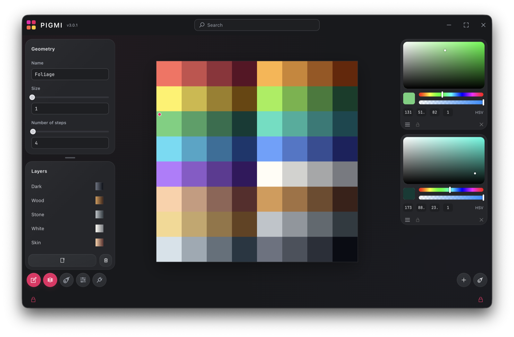

# Pigmi

<p align="center">
  
</p>

<p align="center">
  A desktop editor for texture palettes, gradient atlases, and PBR material maps.
</p>

<p align="center">
  <a href="https://github.com/zironix/Pigmi/releases/latest"><b>Download</b></a> ·
  <a href="https://pigmi.ru">Website</a> ·
  <a href="docs/editor-guide.md">Editor guide</a> ·
  <a href="https://github.com/zironix/Pigmi/issues">Report an issue</a>
</p>



Create gradients, arrange them on a snapping canvas, and export color and material maps for your
assets. Documents are readable JSON files in a folder you choose. Pigmi runs on macOS, Windows,
and Linux.

## Features

- **Gradients** — smooth linear, radial, and conic gradients, stepped rows and columns, RGB and
  HSL interpolation, editable color stops and opacity.
- **Layers** — nested folders, multi-selection, drag-and-drop, visibility, copy/paste, and search.
- **Materials** — albedo, roughness, metallic, emission, clearcoat, and clearcoat roughness, with
  PNG/WebP export of every enabled map plus a packed MRC map.
- **Live sync** — the document and its exports update automatically as you edit.
- **Palette generation** — generate colors through Huemint while keeping locked stops.
- **Blender add-ons** — installed and kept up to date by Pigmi.
- **AI clients** — let an MCP client inspect and edit the open document.

## Download

Get the latest version from [GitHub Releases](https://github.com/zironix/Pigmi/releases/latest):

| Platform            | Package         |
| ------------------- | --------------- |
| macOS Apple Silicon | ARM64 ZIP       |
| macOS Intel         | x64 ZIP         |
| Windows x64         | EXE installer   |
| Linux x64           | AppImage or DEB |

Builds are not notarized or code-signed, so macOS and Windows may ask for confirmation on the
first launch.

## Getting started

1. Open **Settings** (sliders icon) and choose a project folder.
2. Open an existing document with **Load and sync**, or name the current canvas and click
   **Create texture**. Either way, Pigmi saves automatically from then on.
3. Click empty canvas space to create an item, then edit its gradient, colors, size, and material
   in the side panels.
4. Pick the maps to export in Settings. Each enabled map is written next to the document, for
   example `palette_albedo.png` or `palette_mrc.png`.

Pan with the middle mouse button, zoom with Ctrl/⌘ + wheel, and Shift-drag to box-select. The
[editor guide](docs/editor-guide.md) covers every shortcut, layers, export formats, and mix
textures.

## Blender add-ons

Three companion add-ons live in [Pigmi Helpers](Pigmi%20Helpers):

| Add-on                                               | What it does                                                                 |
| ---------------------------------------------------- | ---------------------------------------------------------------------------- |
| [UV to Palette](Pigmi%20Helpers/pigmi_uv2palette.py) | Moves UVs onto palette cells and maps gradients by path, radius, or distance |
| [Highlighter](Pigmi%20Helpers/pigmi_highlighter.py)  | Paints vertex colors from a palette, with preview, save, and restore         |
| [Face to Face](Pigmi%20Helpers/pigmi_face2face.py)   | Saves a mesh part relative to a face or edge and attaches it to other ones   |

Pigmi downloads the latest versions from this repository and installs them into every Blender
version on your computer (**Settings → Blender add-ons**). Enable each add-on once in Blender's
preferences; updates keep it enabled. To install manually, download a `.py` file and add it in
Blender's add-on preferences.

## AI clients (MCP)

Pigmi includes a local MCP server, so a client such as Claude or Codex can read and edit the open
document. Open the plug icon in the bottom-left corner, copy the configuration for your client,
and reload the client. The server needs Node.js. See [Connect an AI client](docs/mcp.md) for
setup, scripting, and troubleshooting.

## Development

```bash
git clone https://github.com/zironix/Pigmi.git
cd Pigmi
npm ci
npm start
```

Run `npm run check` before a pull request (formatting, lint, tests, and packaging). The
[developer guide](docs/development.md) covers the code layout, architecture, and release process;
see also [CONTRIBUTING.md](CONTRIBUTING.md).

## Privacy

Editing and export work offline. Palette generation sends palette constraints to Huemint, and
Pigmi contacts GitHub to check for updates and download the Blender add-ons. The MCP server
talks to Pigmi only over localhost; your AI client decides what it sends to its model. Report
vulnerabilities as described in [SECURITY.md](SECURITY.md).

## License

Pigmi is source-available under the [PolyForm Perimeter License 1.0.1](LICENSE). You may inspect,
use, and modify it, including for commercial work, but you may not use its source to offer a
competing product or service — renamed, rebranded, ported, hosted, or otherwise repackaged, paid or
free — without a separate license. Contact `ziritix@gmail.com` for licensing.

Textures, palettes, material maps, and other content you create with Pigmi are yours to use,
including commercially. Bundled dependencies, fonts, and icons keep their own licenses; see
[THIRD_PARTY_NOTICES.md](THIRD_PARTY_NOTICES.md).
